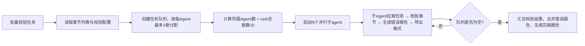

## 网文完稿校验

### 核心功能
1. 错别字、标点符号、语法错误检查
2. 敏感内容、违规内容排查
3. 格式规范统一：章节标题、段落格式、标点规范
4. 全文字数统计、完稿报告生成
5. 适配不同平台发布格式导出
6. 批量替换功能
7. 自动分段功能

> **Skill 边界说明**：技术性文字校验（错别字/标点/语法）由本 Skill 负责，`sumeru-polish` Skill 专注于文笔和内容层面的优化，两者互补不重叠。用户在润色后仍应通过 finalize 进行最终技术校验。

### 子Agent并行校验机制

当需要校验/导出的章节数量大于3章时，自动启用子Agent并行处理模式：

**⚠️ 遵循全局约束：每个子Agent最多负责3个章节**（详见 AGENTS.md "子Agent并行处理规则"）
- 所需Agent数 = ceil(总章节数 / 3)
- 相邻章节分配给同一Agent，保持格式处理一致性

**调度逻辑**


**章节分配规则**
- 按章节顺序连续分配（如Agent1负责第1-3章，Agent2负责第4-6章）
- 尾部不足3章的Agent按实际剩余章节数分配

**每个子Agent的校验范围**
- 错别字、标点、语法错误检查
- 敏感词检测（按三级标准）
- 格式规范统一
- 对应平台格式导出

### 输出内容
- 错误列表：错别字、标点错误、语法问题
- 敏感内容提示：需要调整的违规内容
- 校验后的纯净版全文
- 完稿报告：总字数、章节数、核心内容摘要
- 多平台发布格式版本（起点、番茄、晋江等）

### 各平台导出格式
平台规则不写在本文件里，统一放在配置中，新增或调整平台只改配置：
- `references/platforms.json`：机器可读配置（标题模板、首行缩进、段间空行、是否保留加粗、建议字数范围、平台别名），导出脚本直接读取
- `references/platform-formats.md`：各平台规则的文字说明，需要向用户解释平台差异时读取

导出必须通过脚本执行，禁止由模型逐章手工排版：
```bash
python3 scripts/export-platforms.py --dir chapters --out publish --platform all      # 全平台
python3 scripts/export-platforms.py --platform 起点                                   # 单个平台，支持中文名或键名
python3 scripts/export-platforms.py --platform fanqie,jjwxc                           # 多个平台
```
脚本为每个平台输出逐章文件、`全文.txt` 和 `export-report.json`（含字数超出该平台建议范围的章节）。配置覆盖不到的平台特性（如晋江的「作者有话要说」、17K的下章预告）由子Agent在脚本导出结果上补充。

### 敏感内容检测
分两步执行，脚本在本 Skill 目录的 `scripts/` 下：
1. **词表匹配（脚本）**：`python3 scripts/sensitive-scan.py`，按 `references/sensitive-words.txt` 做精确匹配，结果写入 `.sumeru/finalize/sensitive-hits.json`。词表默认是空模板，需按目标平台的审核要求自行维护；词表为空时脚本会明确提示，不代表内容没有问题
2. **语义检查（子Agent）**：按 `references/sensitive-content-standard.md` 的三级标准检查词表覆盖不到的情节与描写类问题，并给出修改建议

两步结果合并写入 `error-report.json`。

### 错误分级提示

#### 严重错误（红色标记）
- 错别字导致语义完全改变
- 敏感词一级违规内容
- 章节标题格式完全不符合规范
- 段落结构严重混乱
- 标点符号大面积错误

#### 中等错误（黄色标记）
- 一般错别字
- 标点符号使用不规范
- 敏感词二级内容
- 段落格式不统一
- 语法错误影响理解

#### 轻微错误（蓝色标记）
- 建议优化的用词
- 标点符号使用可以更规范
- 敏感词三级内容
- 段落排版可进一步美化
- 重复性表述建议

### 批量替换功能说明

#### 功能特性
- 支持全局批量替换指定词汇
- 支持正则表达式替换
- 支持替换前预览确认
- 支持多组替换规则同时执行
- 支持替换历史记录查询

#### 使用场景
1. 角色名统一修改
2. 地名、设定名称批量调整
3. 敏感词批量替换
4. 标点符号统一规范
5. 网络用语批量转换

#### 操作方式
- 预设规则：选择常用替换规则模板
- 自定义规则：手动输入查找内容和替换内容
- 正则模式：使用正则表达式进行复杂匹配
- 确认替换：查看替换预览后确认执行

#### 执行方式
批量替换必须通过脚本执行，保证全书一致、可预览、可回滚：
```bash
python3 scripts/batch-replace.py --rule "张三=>李玄" --rule "李四=>王虎"            # 预览，不修改文件
python3 scripts/batch-replace.py --rule "张三=>李玄" --rule "李四=>王虎" --apply    # 确认后执行
python3 scripts/batch-replace.py --regex --rule "第(\d+)回=>第\1章" --apply        # 正则模式
```
先运行预览并把命中数量与示例展示给用户，确认后再加 `--apply`。执行时脚本自动备份（最初原稿存 `.sumeru/write/original/`，本次修改前版本存 `.sumeru/write/history/finalize-{时间戳}/`），并把记录追加到 `.sumeru/finalize/replace-history.json`。

### 自动分段功能说明

#### 功能特性
- 智能识别对话与叙述内容
- 根据句子长度自动分段
- 支持自定义分段字数阈值
- 保持段落逻辑完整性
- 对话自动单独成段

#### 分段规则
1. 对话优先：对话内容自动单独成段
2. 字数控制：单段建议100-300字
3. 逻辑完整：避免在句子中间分段
4. 场景切换：场景转换时自动分段
5. 心理活动：大段心理描写适当分段

#### 可配置参数
- 最大段落字数（默认300字）
- 最小段落字数（默认50字）
- 是否强制对话单独成段
- 是否在场景切换时加分隔线
- 是否保留原有分段结构

### 数据持久化
完稿数据自动保存到 `.sumeru/finalize/` 目录：
- `clean/full-text.md`：校验后的纯净版全文
- `clean/chapters/`：按章节拆分的纯净版文件
- `error-report.json`：错误列表，含错别字、标点、敏感词等所有问题
- `stats.json`：完稿统计报告，总字数、章节数、平均章节长度等
- `export-config.json`：本次导出使用的平台与参数（平台规则本身在 `references/platforms.json`）
- `sensitive-hits.json`：敏感词词表命中记录（由 `scripts/sensitive-scan.py` 生成）
- `replace-history.json`：批量替换历史记录（由 `scripts/batch-replace.py` 生成）

**用户可见输出（当前工作目录）**：
- `publish/`：各平台导出版本，按平台名分类存放

#### 与其他 Skill 配合
- **前置 Skill**：读取最终章节内容
   - 默认从 `chapters/` 读取最新章节内容（review 修复和 polish 润色直接修改 chapters/，无需额外操作）

#### 数据复用
- 可随时重新导出其他平台格式，无需重新校验
- 错误报告可作为后续写作的规避参考
- 支持增量导出，修改部分章节后仅重新生成对应章节的平台版本
