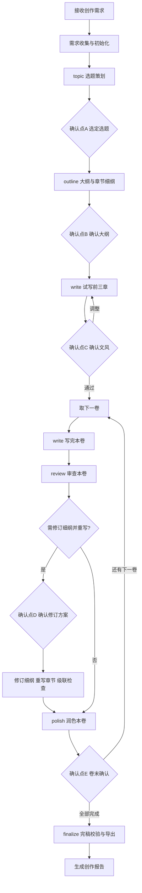

## 网文创作世界构建师 (worldbuilder)

### 核心功能
worldbuilder 是网文创作的一站式主控技能，负责统筹协调从创意萌芽到作品完稿的完整创作链路，构建完整统一的故事世界。通过智能编排各专项技能的调用顺序与参数传递，实现自动化、流水线式的网文创作体验：

1. **选题策划**：调用 `sumeru-topic` 进行市场分析、选题定位，生成核心创意与卖点
2. **大纲设计**：调用 `sumeru-outline` 构建完整世界观、人物设定、分卷大纲与**完整章节细纲**
3. **内容创作**：调用 `sumeru-write` 按大纲进行分章节内容撰写，保持风格统一（**按卷推进，本卷章节全部完成后才进入本卷审查**）
4. **逻辑审查**：调用 `sumeru-review` 对**本卷已完成章节**进行全面审查（同时核对与前面各卷的一致性），校验时间线一致性、人物行为逻辑、前后剧情连贯性
5. **内容润色**：调用 `sumeru-polish` 对**本卷已审查章节**进行文笔优化、细节丰满、节奏调整
6. **完稿校验**：调用 `sumeru-finalize` 在全部分卷完成后，对**所有已润色章节**完成错别字检查、标点规范、逻辑漏洞最终排查与作品打包
**编排方式**：第1-2步只做一次；第3-5步以「卷」为单位循环执行（写完一卷 → 审查该卷 → 润色该卷 → 下一卷）；第6步在全部分卷完成后执行。关键节点设有用户确认点，详见「Skill 协调流程」。

### ⚠️ 全局约束：子Agent并行处理规则

worldbuilder 在协调所有涉及章节级操作的子技能时，强制执行 AGENTS.md 中定义的**子Agent并行处理规则**：

**每个子Agent最多负责3个章节**（硬性约束，详见 AGENTS.md "子Agent并行处理规则"）

此规则适用于以下所有阶段：
- **写作阶段**（sumeru-write）
- **审查阶段**（sumeru-review）：审查和轻量修复
- **润色阶段**（sumeru-polish）
- **完稿阶段**（sumeru-finalize）
- **细纲生成**（sumeru-outline）

**设计原因**：详见 AGENTS.md "子Agent并行处理规则"

**worldbuilder的调度责任**：
- worldbuilder在调用各子技能时，必须确保子技能遵循3章/Agent的约束
- 如果子技能未自动遵守此约束，worldbuilder需要通过参数或指令强制执行
- 监控子技能的执行过程，确认Agent分配符合约束

### Skill 协调流程

worldbuilder 采用**按卷循环**编排：选题和大纲只做一次，之后以「卷」为单位依次执行 写作 → 审查 → 润色，全部分卷完成后统一完稿。问题在一卷之内就被发现和修复，不会等全书写完才返工。

```
用户需求
    ↓
[收集创作需求 → 保存到 .sumeru/session/requirements.json]
    ↓
[sumeru-topic] 选题策划
    → 输出: 选题策划报告.md, .sumeru/topic/options.json
    ↓
【确认点 A】用户选定选题方案
    ↓
[sumeru-outline] 大纲设计（生成完整章节细纲，含分卷信息）
    → 输入: .sumeru/topic/options.json (可选)
    → 输出: 小说大纲_*.md, .sumeru/outline/*.json（含 chapter-outlines.json）
    ↓
【确认点 B】用户确认世界观、人设、分卷大纲与章节细纲
    ↓
[sumeru-write] 试写第1-3章（黄金前三章）
    ↓
【确认点 C】用户确认文风、节奏与人设呈现；不满意则调整风格参数或细纲后重写
    ↓
┌─ 对每一卷循环（按 chapter-outlines.json 的 meta.volumes 顺序）
│
│  [sumeru-write] 写完本卷全部章节（波次并行，每个Agent最多3章）
│      → 输出: chapters/*.md, .sumeru/write/*
│      → 校验: 运行 validate-chapters.py，确认本卷章节齐全、命名合规
│      ↓
│  [sumeru-review] 审查本卷章节，并核对与前面各卷的一致性
│      → 输出: 剧情审查报告.md, .sumeru/review/*
│      → 轻量修复自动执行；「修复 → 验证」最多2轮
│      → 需要修订细纲并重写章节时，先进入【确认点 D】
│      ↓
│  [sumeru-polish] 润色本卷章节（含润色后自检）
│      → 输出: chapters/*.md（直接修改，自动备份）, .sumeru/polish/*
│      ↓
│  【确认点 E】卷末汇报：本卷字数、已修复问题、需人工干预清单；确认后进入下一卷
│
└─ 全部分卷完成
    ↓
[sumeru-finalize] 全书完稿校验与多平台导出
    → 输入: chapters/*.md（已包含各卷 review 修复和 polish 润色后的内容）
    → 输出: publish/*, .sumeru/finalize/*
```

所有章节级操作均遵循全局3章/Agent约束、并发上限与写入隔离规则（详见 AGENTS.md）。

#### 确认点与全自动模式

| 确认点 | 时机 | 需要用户确认的内容 |
|--------|------|--------------------|
| A | 选题完成后 | 选定哪一套选题方案 |
| B | 大纲完成后 | 世界观、人设、分卷大纲、章节细纲 |
| C | 前三章试写后 | 文风、节奏、人设呈现是否符合预期 |
| D | review 要修订细纲并重写章节前 | 修订原因、受影响章节、修订前后对比 |
| E | 每卷结束后 | 本卷成果与遗留问题，是否进入下一卷 |

- 确认只发生在以上节点。轻量修复、润色结果应用、备份等步骤不需要确认（见 AGENTS.md 自动备份规则）
- **全自动模式**：用户明确说「全自动」「无需确认」「不要问我」时，跳过确认点 C、D、E（信息已充足时 A、B 也可跳过，默认采用推荐方案）。所有本应确认的内容必须写入卷末报告，并记录到 `WORLDBUILDER_PROGRESS.json` 的 `pending_review` 列表，供事后查阅
- **短篇或未分卷作品**：把全书视为一卷，循环只执行一次
- **单卷章节过多**（超过50章）：按每30-50章拆成若干「段」，在剧情弧结束处断开，以段为单位执行同样的循环
- **跳过阶段**：用户指定跳过审查或润色时，循环中省略对应步骤，其余不变

#### 关键阶段检查点说明
每个阶段、每一卷完成后都更新 `.sumeru/session/WORLDBUILDER_PROGRESS.json`，任务重启时从上次未完成的卷和阶段继续：
- **大纲阶段**：确认 `chapter-outlines.json` 生成且包含完整章节列表与分卷信息（`meta.volumes`）
- **每卷写作**：运行 `skills/sumeru-write/scripts/validate-chapters.py`，确认本卷章节与细纲一致、命名合规
- **每卷审查**：确认 `剧情审查报告.md` 已包含本卷结果；`bottom-line-checklist.json` 中本卷相关底线问题已标记为「已解决」或「需人工干预」。review 的修复直接修改 `chapters/`（修改前已自动备份）
- **每卷润色**：确认润色已直接修改 `chapters/` 中的文件且润色后自检通过
- **完稿阶段**：确认 `publish/` 目录下各平台格式导出完成

### 数据共享机制

所有 skill 通过 `.sumeru/` 目录共享数据：
- `session/` - 全局会话配置、用户需求、进度状态
- `topic/` - 选题数据 → 供 outline 使用
- `outline/` - 大纲数据 → 供 write、review 使用
  - **`chapter-outlines.json`** - 完整章节细纲 → **供 write 进行并行批量生成**
- `write/` - 创作进度 → 供 review 使用
- `review/` - 审查问题 → 供 write、polish 使用
- `polish/` - 润色结果 → 供 finalize 使用
- `finalize/` - 完稿数据

### 执行流程


**详细流程说明**：
1. **初始化阶段**：验证输入参数有效性，创建工作目录，创建 `.sumeru/session/WORLDBUILDER_PROGRESS.json` 进度文件
2. **需求收集阶段**：判断用户提供的信息是否充足，不足时触发交互式提问补充需求，结果保存到 `.sumeru/session/requirements.json`
3. **选题阶段**：生成3-5个选题方案，用户选定（确认点 A）后进入大纲设计
4. **大纲阶段**：先输出世界观与人设，再生成完整大纲和**所有章节细纲**（含分卷信息），用户确认（确认点 B）后进入写作
5. **试写阶段**：先写第1-3章，用户确认文风、节奏与人设呈现（确认点 C）。前三章决定读者留存，也决定后续全部章节的风格基准，必须先定下来再批量生成
6. **分卷循环**：对每一卷依次执行
    - **写作**：调用 `sumeru-write` 写完本卷全部章节，按波次并行并传递章节衔接上下文；完成后运行 `validate-chapters.py` 校验
    - **审查**：调用 `sumeru-review` 审查本卷。全局审查基于「大纲 + 细纲 + 已完成各卷的章节概要」，章节细节审查只针对本卷。轻量修复自动执行；需要修订细纲并重写章节时先经用户确认（确认点 D），重写后做级联影响检查；「修复 → 验证」最多2轮，仍未解决的标记「需人工干预」
    - **润色**：调用 `sumeru-polish` 润色本卷，子Agent保存前执行润色后自检
    - **卷末确认**：汇报本卷字数、已修复问题与需人工干预清单（确认点 E），更新进度文件后进入下一卷
7. **完稿阶段**：全部分卷完成后调用 `sumeru-finalize`，从 `chapters/` 读取最终内容，执行技术性校验与敏感内容检测，用脚本导出各平台格式到 `publish/`，生成创作总结报告，并把进度文件更新为最终完成状态

worldbuilder 不直接重写章节：细纲修订与章节重写由 review 自身完成（见 AGENTS.md「Skill间解耦规则」）。

### 交互式需求引导
当用户提供的信息过于简略时（仅输入题材和少量关键词），系统会自动触发交互式提问，一步步引导用户明确创作需求，确保生成内容完全符合预期。

#### 提问维度（按优先级）
##### 基础信息确认（必问）
1. 🎯 **题材确认**：确认具体题材细分类型，如"玄幻" → "高武玄幻/修仙玄幻/异世玄幻/系统玄幻"
2. 📏 **篇幅预期**：确认目标字数/章节数，是短篇/中篇/长篇/超长篇
3. 🎯 **核心爽点**：用户最看重的爽点类型，如"打脸/升级/搞钱/恋爱/权谋"
4. 👥 **受众定位**：目标读者群体，男频/女频/全年龄，偏向什么年龄层

##### 核心设定引导（可选，根据需求深度）
5. 🦸 **主角设定偏好**：主角性格（隐忍/张扬/腹黑/逗比）、身份（废柴/天才/穿越者/重生者）、金手指类型偏好
6. 🎭 **反派设定偏好**：反派类型（家族敌人/宗门对手/异族/天道）、反派强度
7. 🌍 **世界观偏好**：偏向什么世界观设定，是否有特别喜欢/讨厌的设定
8. 📖 **参考作品**：是否有类似风格的参考作品，可以更精准匹配风格

##### 风格偏好设置（可选）
9. ✍️ **写作风格**：偏好快节奏爽文/细腻精品文/幽默搞笑文/暗黑压抑文
10. 📱 **发布平台**：计划发布到哪个平台，适配对应平台的节奏和字数要求
11. ⚠️ **禁忌内容**：明确不想要的情节、设定、人物类型

#### 交互模式
- **详细引导模式**：强制开启全量交互式提问，即使用户提供了充足信息也会完整走一遍需求确认流程
- **快速模式**：仅提问最核心的3个问题（题材确认、篇幅、核心爽点），其他使用默认值
- **静默模式**：关闭交互式提问，直接基于已有信息生成，适合明确知道自己需求的用户

#### 需求确认机制
- 所有用户回答自动保存到 `.sumeru/session/requirements.json`，全流程各阶段共享使用
- 提问完成后生成**需求确认摘要**，用户确认无误后才开始正式创作
- 支持中途修改，用户可以随时调整之前的回答

#### 引导示例
```
> /sumeru-worldbuilder 玄幻 "废柴逆袭"
🤖 我来帮您完善创作需求，只需要回答几个简单问题：
1️⃣ 请问您想要的玄幻细分类型是？[高武玄幻/修仙玄幻/异世玄幻/系统玄幻/其他]
> 系统玄幻
2️⃣ 预期总篇幅大概多少字？[20万内/20-50万/50-100万/100万以上]
> 100万以上
3️⃣ 您最看重的核心爽点是？[打脸/升级/扮猪吃虎/收小弟/开后宫/其他]
> 打脸+扮猪吃虎
4️⃣ 主角性格偏好？[隐忍腹黑/张扬霸道/逗比搞笑/温柔沉稳/其他]
> 隐忍腹黑
5️⃣ 有没有特别喜欢的参考作品？比如类似《XX》的风格
> 类似《大王饶命》的搞笑风格
...

✅ 需求收集完成，给您确认一下：
类型：系统玄幻
篇幅：100万字以上
核心爽点：打脸+扮猪吃虎
主角性格：隐忍腹黑
风格参考：《大王饶命》搞笑风
是否确认？[Y/n]
> Y
🚀 开始创作！
```

### 参数说明

创建时需要提供以下信息：
- **作品类型**（必填）：如玄幻、都市、仙侠、科幻、言情、悬疑等
- **核心创意关键词**（必填）：核心创意关键词，支持多个关键词用"+"连接，如"废柴逆袭+系统流+赘婿"

可选信息（不提供则使用默认值或自动生成）：
- **作品标题**：如不提供则自动生成
- **预期篇幅**：短篇（20万字内）/中篇（20-50万字）/长篇（50-100万字）/超长篇（100万字以上），默认中篇
- **写作风格**：快节奏/均衡/详写/文艺，默认均衡
- **整体调性**：幽默/严肃/励志/暗黑，默认中立
- **输出目录**：作品输出目录路径，默认 ./output
- **中断恢复**：传入上次的创作会话ID，可从断点恢复
- **跳过阶段**：跳过指定阶段（topic/outline/write/review/polish/final），适用于续创或团队分工

### 使用示例

#### 基础使用
```
# 最简单的调用方式，只指定类型和关键词
/sumeru-worldbuilder 玄幻 "废柴逆袭+系统流"

# 都市言情作品，指定标题
/sumeru-worldbuilder 言情 "霸道总裁+契约恋爱" 标题"总裁的契约新娘"

# 科幻悬疑，长篇幅，快节奏风格
/sumeru-worldbuilder 科幻 "时间循环+密室解谜" 长篇 快节奏
```

#### 进阶使用
```
# 指定详细参数的完整调用
/sumeru-worldbuilder 仙侠 "重生+无敌流+宗门" 标题"重生之太上掌门" 长篇 详写风格 励志调性

# 从中断点恢复创作
/sumeru-worldbuilder 玄幻 "废柴逆袭+系统流" 恢复上次创作

# 跳过选题阶段，直接从已有大纲继续创作
/sumeru-worldbuilder 都市 "职场+重生" 跳过选题阶段
```

#### 多风格组合
```
# 幽默风都市修仙
/sumeru-worldbuilder 都市 "修仙+打工+搞笑" 均衡风格 幽默调性

# 暗黑系悬疑推理
/sumeru-worldbuilder 悬疑 "连环杀人+心理侧写+反转" 详写风格 暗黑调性

# 热血励志竞技
/sumeru-worldbuilder 竞技 "篮球+天赋+逆袭" 快节奏 励志调性
```

### 错误处理说明

#### 常见错误类型与解决方案

| 错误代码 | 错误信息 | 原因分析 | 解决方案 |
|----------|----------|----------|----------|
| `INVALID_GENRE` | 不支持的作品类型 | 传入的 genre 参数不在支持列表中 | 检查类型拼写，支持的类型：玄幻、都市、仙侠、科幻、言情、悬疑、历史、游戏、竞技、军事、武侠、轻小说 |
| `KEYWORDS_TOO_LONG` | 关键词过长 | keywords 参数超过100字符限制 | 精简关键词，保留最核心的3-5个 |
| `DEPENDENCY_MISSING` | 缺少依赖技能 | 未安装所需的子技能（topic等） | 运行 `/find-skills ` 查找并安装所有依赖技能 |
| `OUTPUT_DIR_PERMISSION` | 输出目录无权限 | 指定的 output-dir 无写入权限 | 更换有权限的目录，或使用默认目录 |
| `INVALID_SESSION_ID` | 无效的会话ID | resume 参数传入的会话ID不存在 | 检查会话ID是否正确，或重新开始创作 |
| `STAGE_SKIP_CONFLICT` | 阶段跳过冲突 | 跳过的阶段与后续阶段有依赖关系 | 移除对前置阶段的跳过，或提供必要的前置文件 |
| `CONTENT_GENERATION_FAILED` | 内容生成失败 | 创作过程中遇到内容审核或模型限制 | 调整关键词或风格参数，或分阶段手动确认 |

#### 错误恢复机制
- **自动重试**：对于临时性网络错误，自动重试3次，间隔5秒
- **断点保存**：每完成一个阶段自动保存状态，支持从中断点恢复
- **回滚选项**：对不满意的阶段可选择回滚到上一节点重新开始
- **错误报告**：生成详细的错误日志文件，位于 `{output-dir}/error.log`

### 进阶使用场景
团队协作、多版本对比、系列作品、A/B测试、批量生成素材库等用法示例见 `references/advanced-scenarios.md`，需要时再读取。

### 数据持久化规范
所有中间状态数据统一存储在当前工作目录的 `.sumeru/` 目录下，避免上下文压缩或清理导致数据丢失：

#### 全局存储结构
```
.sumeru/
├── session/          # 会话全局数据
│   ├── requirements.json # 创作需求与配置参数（用户回答、风格、篇幅等）
│   ├── WORLDBUILDER_PROGRESS.json # 全流程进度追踪（唯一进度来源，断点恢复依据）
│   └── history.log   # 操作历史记录
├── topic/            # 选题阶段输出
│   ├── report.md     # 完整选题策划报告
│   └── options.json  # 多选题方案原始数据
├── outline/          # 大纲阶段输出
│   ├── world.json    # 世界观设定（结构化，供后续 skill 复用）
│   ├── world.md      # 世界观设定备份
│   ├── characters.json # 人物设定卡
│   ├── plot.md       # 剧情大纲
│   ├── plot-outline.json # 剧情大纲结构化数据
│   └── chapter-outlines.json # **完整章节细纲（核心输出）**
├── write/            # 创作阶段输出
│   ├── original/     # 最初原稿备份（首次修改前备份，之后不覆盖）
│   ├── history/      # 各阶段修改前快照（按 阶段-时间戳 分目录）
│   └── progress.json # 创作进度跟踪
├── review/           # 审查阶段输出
│   ├── timeline.json # 时间线数据
│   ├── issues.json   # 问题清单
│   ├── fix-plan.json # 修复执行记录（已执行的修复操作详情）
│   ├── outline-revisions.json # 大纲修订记录
│   ├── bottom-line-checklist.json # 底线问题清单
│   ├── rewrite-chapters/ # 重写章节修订记录
│   └── plot-map.json # 剧情脉络图
├── polish/           # 润色阶段输出
│   ├── diff/         # 修改对比文件
│   ├── summary.json  # 润色统计报告
│   └── style-config.json # 润色风格配置
└── finalize/         # 完稿阶段输出
    ├── clean/        # 纯净版全文
    ├── error-report.json # 错误与敏感内容清单
    ├── sensitive-hits.json # 敏感词词表命中记录
    └── stats.json    # 完稿统计（各平台导出文件在 publish/）
```

#### 进度保存机制
`.sumeru/session/WORLDBUILDER_PROGRESS.json` 是全流程**唯一**的进度来源，每个阶段、每一卷完成后更新。完整字段与示例见 `references/progress-schema.md`，读写进度文件前先读取该文件。要点：
- `stages`：topic / outline / write / review / polish / finalize 各阶段的总体状态与输出文件
- `volumes`：按卷记录 write / review / polish 的状态，断点恢复时据此定位到具体的卷和步骤
- `pending_review`：全自动模式下被跳过的确认项，供用户事后查阅

#### 数据生命周期管理
1. **自动保存**：每完成一个阶段自动将数据写入对应目录，支持幂等写入
2. **进度追踪**：每个阶段完成后自动更新 `.sumeru/session/WORLDBUILDER_PROGRESS.json`，记录阶段状态与完成时间
3. **版本控制**：关键节点自动生成版本快照，命名格式 `{stage}-{timestamp}.json`
4. **断点恢复**：恢复创作时自动从 `.sumeru/` 目录读取对应阶段数据
5. **清理规则**：支持清理所有中间数据，默认保留最近3个版本
6. **数据复用**：可直接引用其他项目的 `.sumeru/` 目录数据，实现世界观/人设复用

### 高级配置：自定义阶段钩子（规划中）

> ⚠️ 该能力为规划中特性，当前版本暂未实现，仅作为扩展接口预留。

通过配置文件 `{output-dir}/hooks.json` 可以在各阶段前后插入自定义处理：
```json
{
  "before_topic": "my-preprocess-script.sh",
  "after_outline": "validate-outline.js",
  "before_write": "setup-write-env.py",
  "after_final": "deploy-to-platform.sh"
}
```
